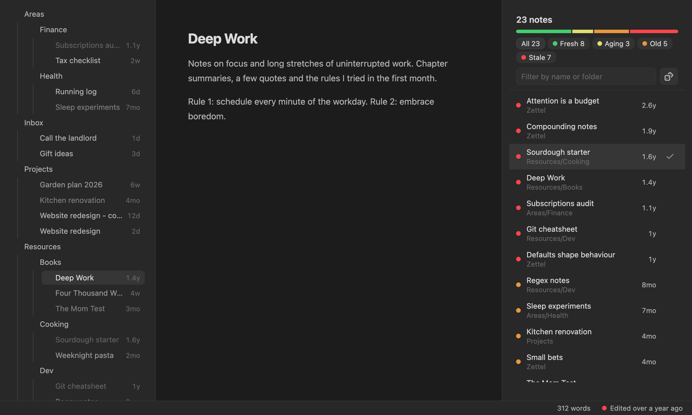
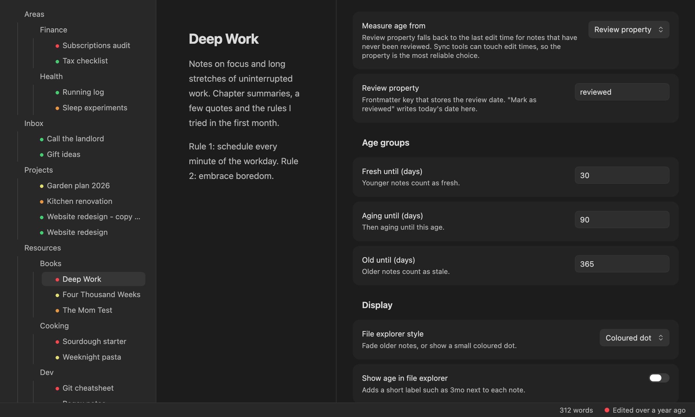

# Note Aging

See which notes you haven't touched in a while.

Old notes quietly pile up. Note Aging shows how long it has been since you last reviewed (or edited) each note, so you can spot the forgotten corners of your vault and decide what to update, merge or archive. The idea comes from Trello's card aging power-up and the long-standing [Note aging](https://forum.obsidian.md/t/note-aging/467) plugin request on the forum.

## Features

- **File explorer at a glance.** Older notes fade out, or get a small coloured dot (fresh, aging, old, stale). Optional short age labels such as `3mo` or `1.4y`.
- **Aging notes view.** A side panel that lists notes oldest first, with counts per group, a filter box and one-click "mark as reviewed".
- **Mark as reviewed.** Writes today's date to a frontmatter property (`reviewed` by default). Works from the command palette, the file menu (also for several selected files), the side panel or by clicking the status bar.
- **Random old note.** Opens a random note older than N days, with older notes more likely to come up. Good for a weekly gardening session.
- **Status bar.** Shows how long ago the open note was reviewed or edited.
- **Your rules.** Pick what age is measured from (review property, last edit, creation), set the day thresholds for each group and exclude folders like daily notes or templates.

## How age is measured

By default the plugin reads the `reviewed` property. Notes that have never been reviewed fall back to their last edit time. You can switch to edit time or creation time in settings.

A note on edit times: sync tools and some scripts touch files without you editing them, which makes notes look newer than they are. The review property does not have that problem, so it is the default.

## Commands

- Open aging notes
- Mark current note as reviewed
- Open a random old note

## Installing

From Obsidian: Settings, Community plugins, Browse, search for "Note Aging".

Manually: download `main.js`, `manifest.json` and `styles.css` from the latest release into `<vault>/.obsidian/plugins/note-aging/`.

## Privacy

Everything runs locally. The plugin makes no network requests and collects no data. The only file changes it makes are the review property it writes when you mark a note as reviewed.

## License

MIT

---

Made by [E:LAB](https://elab-studio.com). Also from us: [Vault Tidy](https://github.com/didrod205/vault-tidy), for renaming and merging tags, bulk-editing properties and vault-wide find and replace.
